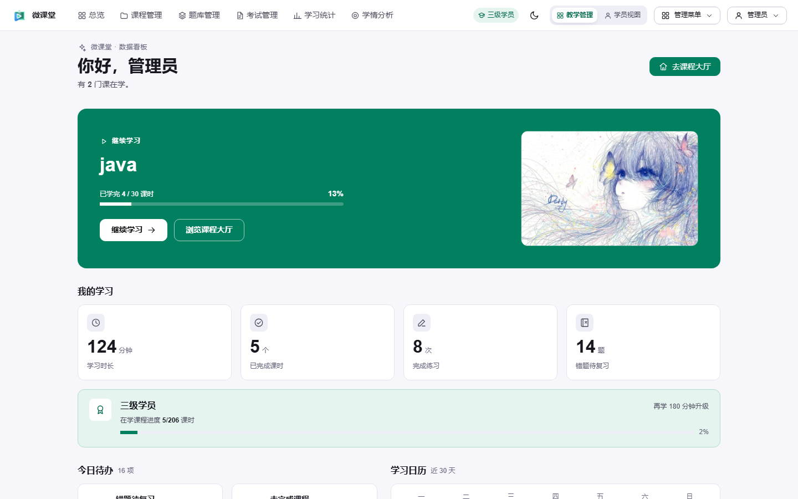
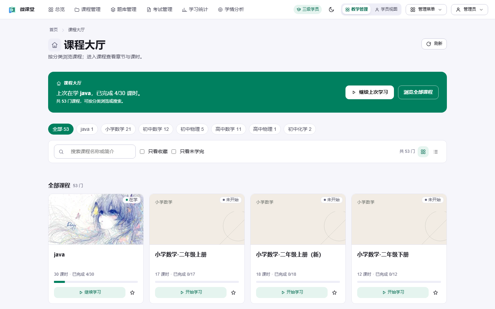
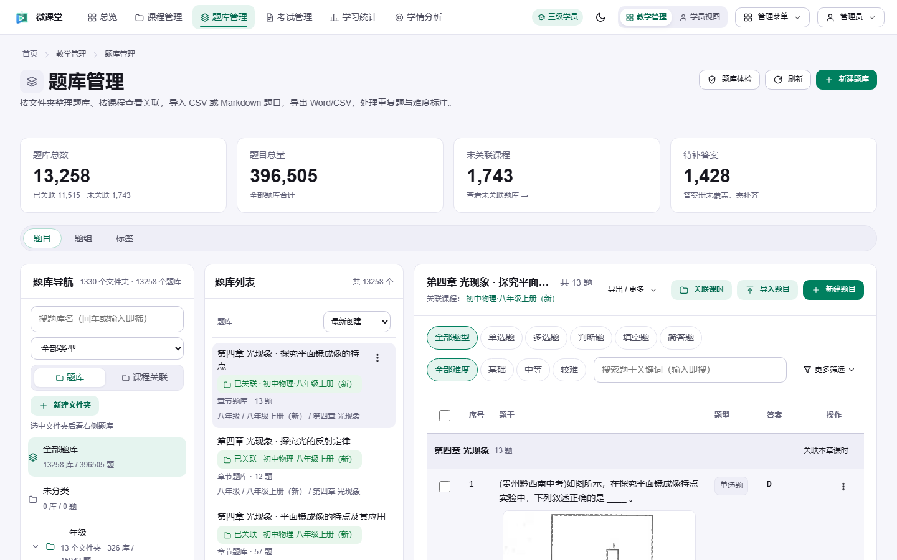
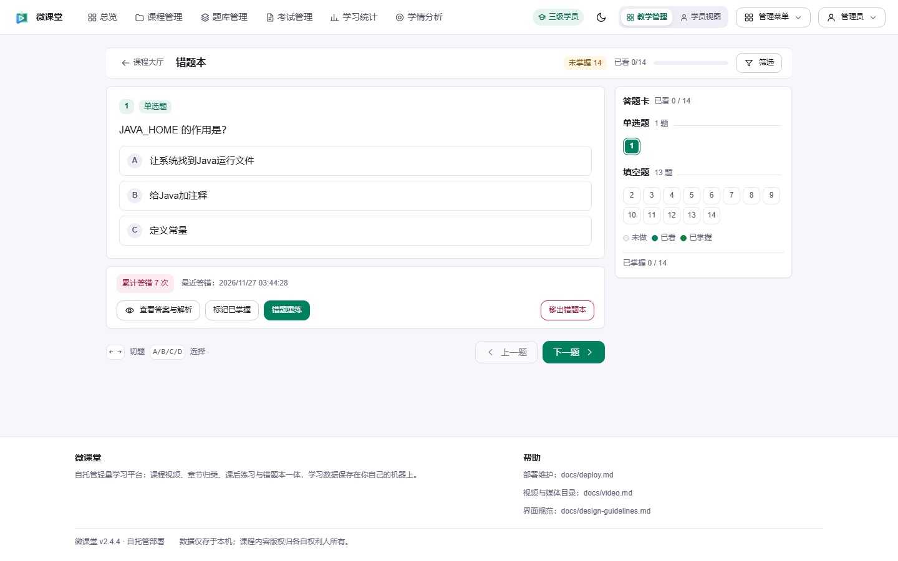
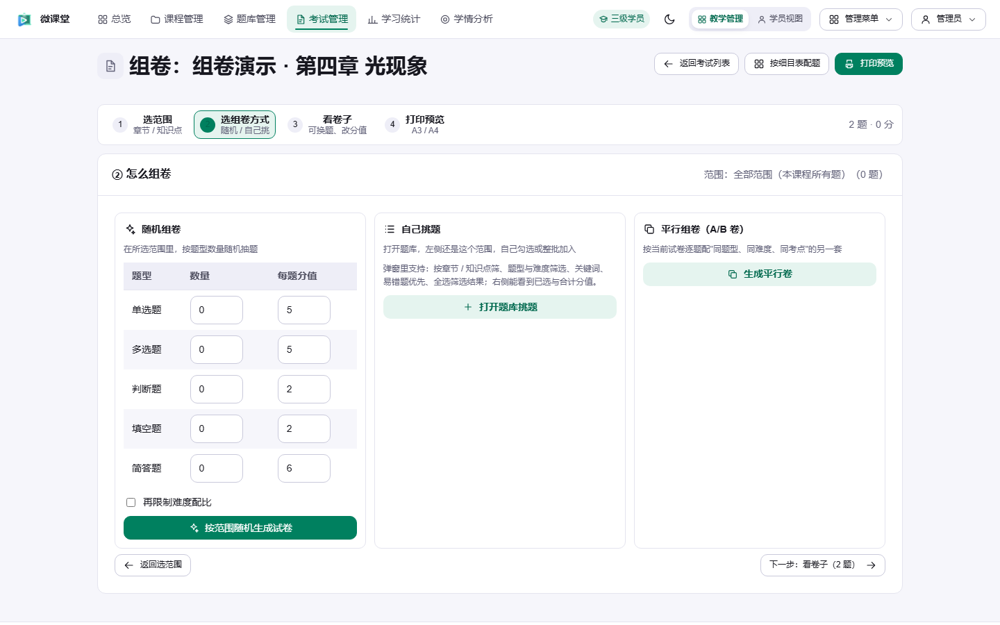
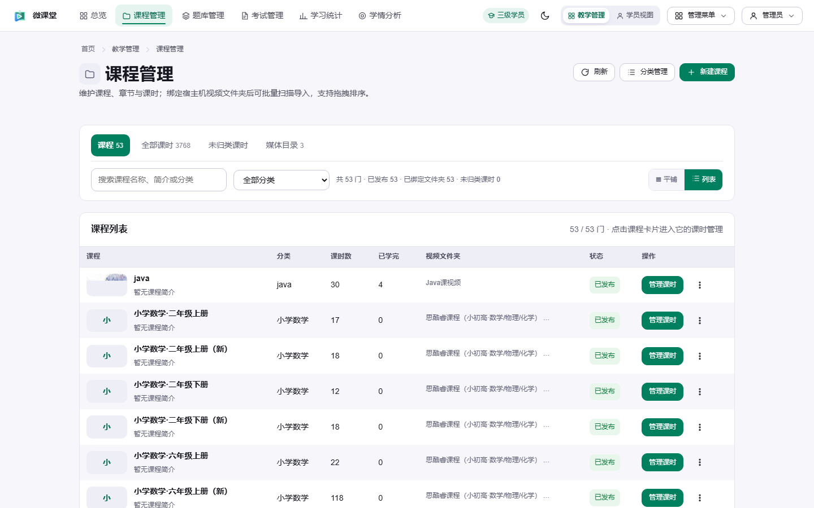
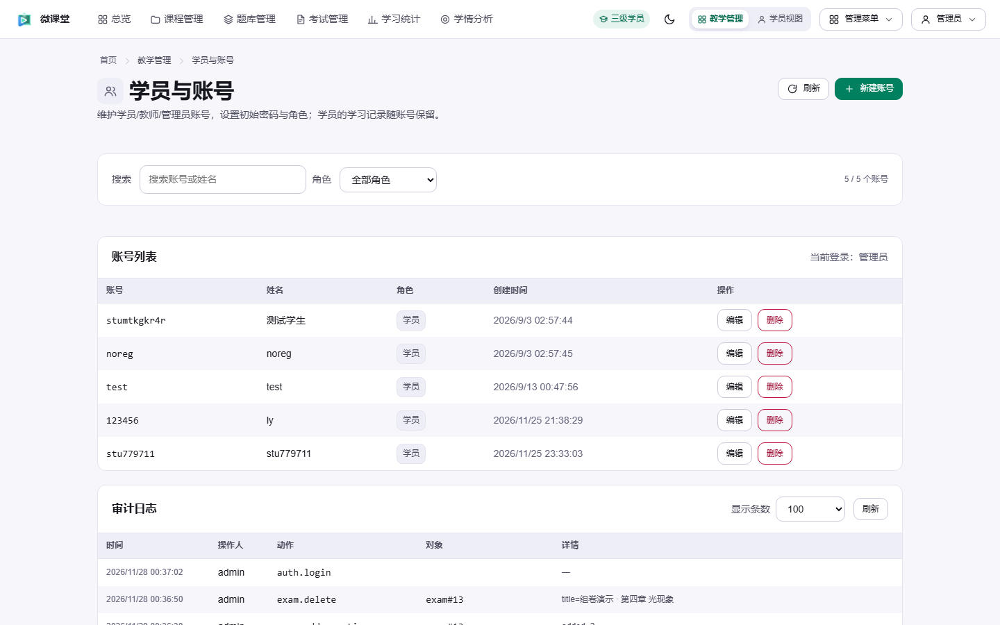
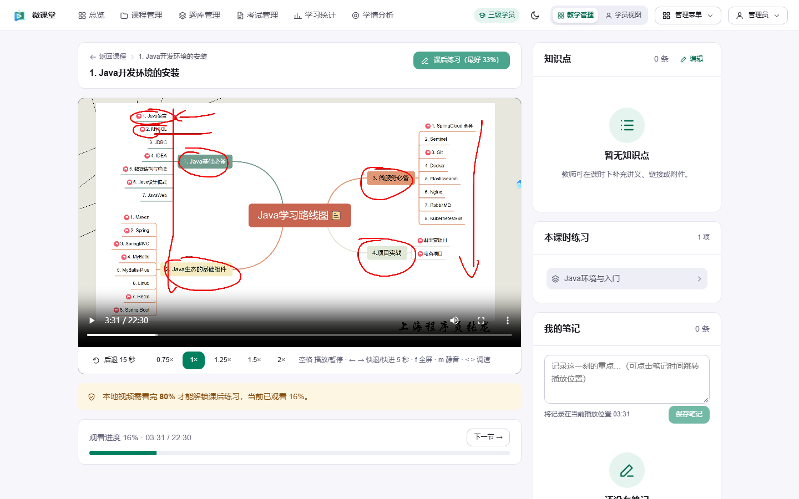
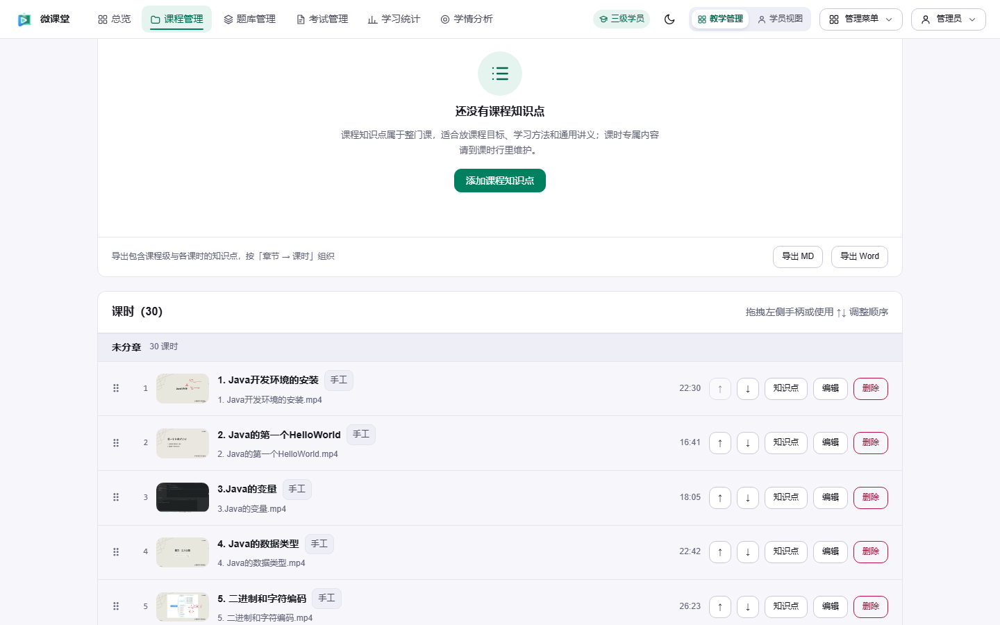

# 微课堂 MicroClass

> 面向班级与机构的**轻量学习平台**：课程 → 章节 → 课时、题库与考试、学习进度与错题本。
> 生产环境采用 **PostgreSQL 16 + 连接池 + 异步数据访问**，同时保留 SQLite 单文件模式（本地开发、单机轻量与回滚）；
> 数据自持、可离线部署。

[](../../actions/workflows/ci.yml)


---

## 截图

| 学生端 · 首页看板                 | 学生端 · 课程大厅                 |
| --------------------------------- | --------------------------------- |
|  |  |

| 教师端 · 题库管理                       | 错题本（答对自动标记掌握）            |
| --------------------------------------- | ------------------------------------- |
|  |  |

| 组卷向导（随机 / 挑选 · 平行卷）          | 课程 / 课时管理                           |
| ----------------------------------------- | ----------------------------------------- |
|  |  |

| 学员与权限                                 | 学生端 · 观看页（断点续播）            |
| ------------------------------------------ | -------------------------------------- |
|  |  |

## 架构（2.4.4）

生产当前跑 **`microclass:2.4.4` + PostgreSQL 16**（Compose 服务 `api` + `db`，`MC_DB=pg`）；
`GET /api/v1/readyz` 会回报当前驱动（`{db:"ok",driver:"pg"}`）。

| 模式           | 开关                                      | 典型场景                      | 数据                                                      |
| -------------- | ----------------------------------------- | ----------------------------- | --------------------------------------------------------- |
| PostgreSQL     | `MC_DB=pg` + `MC_PG_URL=postgres://…`     | 生产、多实例 / 读写分离的底座 | `postgres:16-alpine`，30 张表 / 21 个外键 / 3 个触发器    |
| SQLite（默认） | `MC_DB=sqlite`（不配 `MC_PG_URL` 也是它） | 本地开发、单机轻量、生产回滚  | `data/microclass.db`（WAL），迁移编号与 PG 共用同一套 SQL |

**为什么换 PG**：`node:sqlite` 的 `DatabaseSync` 是**同步 API** —— 机械盘上一次冷页扫描就会占住整个 Node 事件循环，
`/healthz` 也跟着超时（2026-11-26 曾整站无响应约 5 分钟，只能靠看门狗重启）。PG 版本把数据访问改为
**连接池 + 异步仓储**，慢查询不再阻塞请求线程：`/banks/catalog` 冷页从 SQLite 的 **54.6 s** 降到 PG 热态 **2.8 ms**。

- **统一数据端口**：所有仓储走 `AsyncDb`；`?` 占位符自动改写为 `$n`，`transaction(async tx)` 保证同一连接、抛错整批回滚，自增统一 `INSERT … RETURNING id`。
- **方言收敛**：SQLite / PG 差异集中在 `apps/api/src/db/sql.ts` 的辅助函数（`nowSeconds`、`maxOf` → `GREATEST`、`likeCI`、`nullSafeEq`、JSON 展开等），仓储里不散落 `if (driver === 'pg')`。
- **连接池**：默认 `max=10`、`idleTimeoutMillis=30 s`、连接超时 10 s、`application_name=microclass-api`；int8 / numeric 统一解析成 `number`，PG 不会把计数返回成字符串。
- **SQLite 兼容模式**：WAL + 页缓存 256 MB + `mmap_size=256 MB`（2.4.1 回退，避免机械盘逐页缺页）+ 只读连接 `query_only=ON`；生产 SQLite 卷不参与切流，回滚时改回 `MC_DB=sqlite` 即可。
- **迁移**：`db/migrations/NNNN_*.sql` 编号顺序执行，**只增不改**；`schema_migrations` 记录版本与校验和，改动历史迁移会直接报错。

## 功能

**学生端**

- **课程与课时**：课程大厅（分类 / 搜索 / 收藏）、课程详情、观看页（本地视频、外链 / 嵌入、断点续播、倍速与快捷键、播完自动下一节）。
- **知识点**：课程级 / 课时级挂载，Markdown / Word / 附件与配图，观看页侧栏折叠展示，可导出 MD / Word。
- **刷题**：学习通式答题卡（已看 / 未做 / 标记）、即时判分、课后练习（本地视频看完 80% 解锁）。
- **错题本**：答错自动收录，答对自动标记掌握；支持错题重练、按知识点与状态筛选。
- **考试**：在线答题、交卷判分、成绩单与逐题解析。
- **学情**：学习日历（近 30 天热力 + 连续天数）、学习时长 / 完成度 / 等级、继续学习与推荐课程。
- **其他**：站内公告、个人中心、课程封面缩略图。

**教师 / 管理端**

- **题库管理**：CSV / Markdown / Word 导入导出、五种题型、图片题、重复题与冲突题核对、难度模型（人工标注优先 + 批量校准）、题库文件夹树、按册次批量归类、教师版题库覆盖导入、显示偏好与键盘流。
- **题组与变式**：同一考点的「一道母题 + 若干变式」关联成组，题目可同属多组；题库按题组筛选，组卷可「整组加入（母题在前）」。
- **自由标签与高级检索**：易错 / 高考真题 / 自编 / 需重录等教研标签，支持批量加减；按标签、知识点多选检索，可选「任意一个 / 同时包含」两种模式。
- **组卷**：按章节 / 知识点圈范围 → 随机组卷或自己挑题（可按题组、标签筛题）→ 卷内换题与改分 → 打印预览（A3 / A4）；支持**双向细目表组卷**与**平行卷（A/B）一键生成**。
- **课程与课时管理**：媒体目录扫描导入、章节分组、拖拽排序、封面与知识点附件。
- **考试与成绩**：考试管理、随机 / 手挑组卷、成绩单、导出 Word / PDF。
- **学员与权限**：账号 / 角色 / 重置密码，写操作审计。
- **公告**：级别 / 置顶 / 草稿，首页展示、点击看全文。
- **学情分析**：课程 / 学员 / 知识点维度的统计与图表。

**运维**

- Docker（多阶段 + 非 root + 健康检查）、Compose 双服务（api + db）、fnOS FPK 学生端；
- 备份（`pg_dump` 每日 + SQLite 卷）、看门狗与维护锁、部署预热、OpenAPI 3.1、结构化日志与审计。

## 视频挂载（3 步）

平台不搬运视频，只**索引**你磁盘上已有的文件：媒体目录（白名单）→ 课程绑定文件夹 → 扫描成课时。
一级目录默认就是章节名，扫完自动生成章节与顺序。

```text
1) 宿主机放好视频：/volume1/media/math7/七年级上册/第一章 有理数/1.1 正数和负数.mp4
2) 启动容器时挂载 + 登记（容器内路径）：
     -v /volume1/media/math7:/media/math7:ro
     MC_MEDIA_ROOTS=[{"id":"math7","name":"数学·七年级","path":"/media/math7"}]
3) 后台：课程管理 → 课程 → 管理课时 → 绑定视频文件夹 → 预览扫描 → 正式扫描
```

| 教师端 · 课时管理（绑定文件夹 / 扫描 / 拖拽排序） | 学生端 · 观看页（断点续播、可拖动进度） |
| ------------------------------------------------- | --------------------------------------- |
|         |   |

也可以**网页直接上传**（无需宿主机权限，受 `MC_MAX_VIDEO_MB` 限制），或填**外链 / 嵌入**（B 站、自建 CDN，不占服务器磁盘）。

- 完整指南（目录约定与命名、`chapterMode` 章节规则、扫描幂等性、权限、时长与封面、播放机制、排错表、最小可用流程）：**[docs/video.md](docs/video.md)**
  —— **Docker / 本地 + systemd / fnOS FPK 三种部署方式的媒体目录配置各不相同**（容器内路径 vs 宿主机绝对路径 vs NAS 真实路径），文档里都有对应步骤与验证命令。
- 容器挂载与权限：**[docs/deploy.md](docs/deploy.md)**

## 部署（生产形态）

### Docker Compose（api + db）

`ops/docker/compose.evo4.yml` 固定项目名 `microclass-prod`，两个服务：

- `db`：`postgres:16-alpine`，数据目录 bind 到 `/vol1/1000/microclass-pg`，只监听 `127.0.0.1:55432` 供运维排查；
- `api`：`microclass:${MC_VERSION}`，8091（历史入口 8093 指向同一实例），非 root `1000:1000`，健康检查走 `/api/v1/healthz`。

```bash
# 1) 构建镜像（版本号同时进包与运行时）
docker build -f ops/docker/Dockerfile --build-arg MC_VERSION=2.4.4 -t microclass:2.4.4 .

# 2) 准备 .env（ops/docker/.env.evo4.example 复制后补齐；缺 MC_VERSION / MC_PG_PASSWORD 会直接报错）
#    MC_VERSION=2.4.4
#    MC_DB=pg
#    MC_PG_URL=postgres://microclass:<密码>@db:5432/microclass
#    MC_PG_PASSWORD=<同一个密码>
#    MC_ADMIN_PASS=<首次初始化的管理员密码>
docker volume create microclass_data          # 首次部署；数据卷是 external，编排不会重建它
cd ops/docker && docker compose -f compose.evo4.yml up -d
curl -fsS http://127.0.0.1:8091/api/v1/readyz  # {"status":"ready","db":"ok","driver":"pg"}
```

> `compose.evo4.yml` 里的 `/vol1/...`、媒体目录与 `user: 1000:1000` 是 fnOS / NAS 的实际路径；
> 换机器部署请同步修改 volume 与 `MC_MEDIA_ROOTS`。完整步骤、权限与排错见 [docs/deploy.md](docs/deploy.md)。

### fnOS FPK 学生端

`ops/fpk/` 产出的是**学生端应用**：包内只有学生版前端 + 零依赖网关，`/api/*` 反向代理到 Docker 生产（`127.0.0.1:8091`），
应用端口 8092。**账号、学习记录、题库只有一份**（在 Docker 里），不存在两边不同步；教学 / 题库 / 系统管理仍只在 Docker 版提供。

```bash
bash ops/fpk/build.sh                          # 组装（学生版前端 + proxy.mjs）
bash ops/fpk/build.sh --with-fnpack            # 在 NAS 上直接打包
appcenter-cli install-fpk /tmp/microclass/microclass.fpk
```

详见 [ops/fpk/README.md](ops/fpk/README.md)。

### 备份（pg_dump 每日 + SQLite 卷）

统一入口 `ops/deploy/backup.sh`：PG 逻辑备份（`pg_dump -Fc`）+ SQLite 卷 tar，任一失败退出非零。

```bash
sudo install -m 755 ops/deploy/pg-backup.sh /vol1/1000/microclass-deploy/pg-backup.sh
sudo install -m 755 ops/deploy/backup.sh    /vol1/1000/microclass-deploy/backup.sh
sudo bash /vol1/1000/microclass-deploy/backup.sh        # 先手动跑一次

# root crontab：每天 03:30
# 30 3 * * * /vol1/1000/microclass-deploy/backup.sh >> /var/log/microclass-backup.log 2>&1
```

- 保留：PG dump **7 份**、SQLite 卷 **3 份**；实测一份 PG dump 约 121 MB / 约 20 s，SQLite 卷 tar 在慢盘上可能约 25 分钟。
- 告警：`/vol1` 使用率 ≥85%、最新 dump < 50 MB、dump 环比缩小 >30% 都会写 warning。
- **恢复演练每季度一次**：恢复进临时库 `microclass_restore_test` 校验行数后立即 `DROP`，不碰生产库。步骤见 [docs/ops-runbook.md](docs/ops-runbook.md) §7。

### 看门狗与维护锁

`ops/deploy/watchdog.sh` 每 2 分钟探一次 `/healthz`；**连续 2 次**失败才 `docker restart microclass-api`，
重启后 20 s 复查，仍失败就只记日志（防重启风暴）。维护窗口（切库 / 迁移 / 手工停服）先上锁：

```bash
sudo touch /vol1/1000/microclass-deploy/.maintenance    # 看门狗只记一行「维护中，跳过重启」
# … 停 api / 备份 / 切库 / redeploy …
sudo rm -f /vol1/1000/microclass-deploy/.maintenance
```

### 部署预热

`ops/deploy/redeploy.sh` 在 `readyz=200` 之后、宣布成功之前，顺序预热 `/banks/catalog`、
`/banks/catalog-sections?view=book`、`/courses`、`/settings`、`/announcements`（各 180 s 超时，失败只告警），
把冷页焐热再放流量。不重新部署时的手动预热命令见 [docs/deploy.md](docs/deploy.md) §11。

### 回滚

```bash
# L2：回上一版镜像（数据层不变，PG 数据不受影响）
printf '2.4.3' > .image-tag && bash redeploy.sh

# L1：同版本镜像 + MC_DB=sqlite（SQLite 卷全程未动，切流前的数据还在）
#     注意：切流后写入 PG 的数据不会回灌 SQLite，只用于「刚切流就发现问题」的即时回退
sed -i 's/^MC_DB=pg$/MC_DB=sqlite/' .env
docker compose -f compose.evo4.yml up -d --force-recreate --no-deps api
```

## 快速开始

### 本地开发（Node ≥ 22.5，npm workspaces）

```bash
git clone https://github.com/Skarie/microclass.git
cd microclass
npm install
cp .env.example .env          # 默认 MC_DB=sqlite，至少改 MC_ADMIN_PASS
npm run migrate               # 建库 + 迁移
npm run dev                   # API: http://127.0.0.1:8091/api/v1
npm run dev:web               # 前端 dev server（另开一个终端，代理 API）
```

首次启动会按 `MC_ADMIN_USER` / `MC_ADMIN_PASS` 引导创建管理员（默认 `admin` / `admin123`，**正式环境请立即修改**）。
本地默认就是 SQLite（`data/microclass.db`），不需要装 PG。

### Docker 部署

见上文「部署（生产形态）→ Docker Compose」：构建 `microclass:2.4.4` → `.env` 填 `MC_VERSION` / `MC_PG_PASSWORD` / `MC_ADMIN_PASS` / `MC_PG_URL` → `compose up -d`。

## 技术栈

| 层   | 选型                                                                                                             |
| ---- | ---------------------------------------------------------------------------------------------------------------- |
| 后端 | TypeScript · Fastify 5 · `AsyncDb`（PG 连接池 / `node:sqlite`）· 分层：routes → services → repositories → domain |
| 前端 | Vue 3.5 · Vite 7 · Pinia · vue-router · 自建设计系统（明暗双主题、令牌化、可访问性守卫）                         |
| 数据 | PostgreSQL 16（生产）· SQLite（默认 / 回滚）· 编号 SQL 迁移（`schema_migrations` + 校验和）                      |
| 质量 | prettier · eslint · vue-tsc · vitest · Playwright · GitHub Actions（质量 + E2E + Docker 冒烟）                   |

架构与依赖方向：[docs/architecture.md](docs/architecture.md)｜接口：[docs/api.md](docs/api.md)（运行时 OpenAPI：`GET /api/v1/openapi.json`）

## 目录结构

```
apps/api         后端服务（routes → services → repositories → domain；db/pg 为 PG 连接池与异步适配）
apps/web         前端应用（Vue3 + Vite + TS，含自建设计系统）
packages/shared  前后端共享类型 / 常量 / 错误码
db/migrations    编号 SQL 迁移（SQLite / PG 同源）
ops              部署与运维（Docker / Compose / FPK / 备份 / 看门狗 / PG 工具链）
docs             架构 / API / 部署 / 运维 / 迁移 / 安全 / 发布 / 使用说明
tests/e2e        Playwright 端到端测试
```

## 常用命令

| 命令                                                          | 说明                                          |
| ------------------------------------------------------------- | --------------------------------------------- |
| `npm run dev` / `npm run dev:web`                             | 启动 API（tsx watch） / 前端 dev server       |
| `npm run build`                                               | 构建 shared → api → web                       |
| `npm run format:check` / `npm run lint` / `npm run typecheck` | 格式 / 规范 / 类型门禁                        |
| `npm run test` / `npm run test:coverage`                      | 单元与集成测试 / 覆盖率门禁                   |
| `npm run test:e2e`                                            | Playwright 端到端测试（需先 `npm run build`） |
| `npm run migrate`                                             | 执行数据库迁移（SQLite 或 PG）                |
| `npm run verify:size`                                         | 单文件行数守卫（300 行硬上限 + 历史基线）     |
| `npm run backup` / `npm run restore`                          | 数据备份 / 恢复（SQLite 一致性快照）          |
| `npm start`                                                   | 生产模式启动（需先 build）                    |

## 配置

完整变量见 [.env.example](.env.example)。常用项：

| 变量                                               | 默认                  | 说明                                            |
| -------------------------------------------------- | --------------------- | ----------------------------------------------- |
| `MC_ENV`                                           | `development`         | `development` / `test` / `production`           |
| `MC_HOST` / `MC_PORT`                              | `0.0.0.0` / `8091`    | 监听地址与端口                                  |
| `MC_DB`                                            | `sqlite`              | `sqlite` / `pg`；生产为 `pg`                    |
| `MC_PG_URL`                                        | 空                    | PG 连接串（仅 `MC_DB=pg` 时使用，含密码勿提交） |
| `MC_DATA_DIR`                                      | `./data`              | 数据目录（SQLite、上传、会话密钥）              |
| `MC_SITE_NAME`                                     | `微课堂`              | 站点名称                                        |
| `MC_ADMIN_USER` / `MC_ADMIN_PASS`                  | `admin` / `admin123`  | 首次引导管理员（已存在则不覆盖）                |
| `MC_ALLOW_REGISTER`                                | `true`                | 是否开放学生自助注册                            |
| `MC_SESSION_SECRET`                                | 自动生成              | 会话签名密钥（未配置则写入 `data/.secret`）     |
| `MC_MAX_VIDEO_MB` / `MC_MAX_UPLOAD_MB`             | `2048` / `50`         | 上传上限                                        |
| `MC_MEDIA_ROOTS`                                   | 空                    | 允许登记为媒体目录的宿主机路径                  |
| `MC_RATE_LIMIT_MAX` / `MC_RATE_LIMIT_WINDOW`       | `300` / `1 minute`    | 限流                                            |
| `MC_ALLOWED_ORIGINS` / `MC_TRUST_PROXY` / `MC_CSP` | 空 / `true` / `false` | 反向代理与跨站策略                              |

> PG 部署还需要 `MC_PG_PASSWORD`（Compose 的 `db` 服务读取）；PG 目录、连接串与备份的完整说明见
> [docs/postgres-migration.md](docs/postgres-migration.md) 与 [docs/ops-runbook.md](docs/ops-runbook.md)。

## 测试与质量门禁

```bash
npm run format:check && npm run lint && npm run typecheck && npm run test && npm run build
npm run verify:size            # 631 个文件 / 技术债 19 个
npx playwright test            # 端到端（面向生产构建产物）
```

当前状态（2.4.4）：单元与集成测试 **1152 通过 + 35 跳过**；Playwright E2E **40/40**（含视觉回归与无障碍检查）；
文件行数守卫 **631 个文件 / 待偿还技术债 19 个**。

CI 会在每次 PR 跑「质量 / E2E / Docker 镜像冒烟」三个 job，并设 `npm audit --omit=dev --audit-level=high` 依赖漏洞门禁。

**工程约束**：任何写操作都要有 schema 校验、鉴权守卫与审计记录；错误统一走错误信封；新增表结构必须通过迁移文件，不修改历史迁移。
参与开发前请读 [CONTRIBUTING.md](CONTRIBUTING.md)。

## 文档

**使用**

- 教师 / 学生使用说明：[docs/usage.md](docs/usage.md)
- 视频挂载与播放：[docs/video.md](docs/video.md) / [docs/video-playback.md](docs/video-playback.md)
- 接口说明（另有 OpenAPI 3.1）：[docs/api.md](docs/api.md)

**部署与运维**

- 部署（Docker / 本地 + systemd / fnOS FPK / 反向代理 / 升级回滚 / 自检清单）：[docs/deploy.md](docs/deploy.md)
- 运维手册（巡检、日志、备份恢复、看门狗、定时任务）：[docs/ops-runbook.md](docs/ops-runbook.md)
- SQLite → PostgreSQL（为什么换、Schema 映射、工具链、方言差异、实测）：[docs/postgres-migration.md](docs/postgres-migration.md)
- PG 切流 Runbook（步骤 / 验证证据 / 回滚）：[docs/pg-cutover-runbook.md](docs/pg-cutover-runbook.md)

**架构与规范**

- 架构与依赖方向：[docs/architecture.md](docs/architecture.md)
- 界面设计规范：[docs/design-guidelines.md](docs/design-guidelines.md)
- 代码规范（文件行数、分层、组件边界）：[docs/code-standards.md](docs/code-standards.md)
- 安全设计与复核记录：[docs/security.md](docs/security.md)
- 版本与发布、升级回滚：[docs/release.md](docs/release.md)
- 变更记录：[CHANGELOG.md](CHANGELOG.md)

**内部资料**

- PG 迁移进度与交接（按 commit 的过程记录、排查笔记）：[docs/pg-migration-progress.md](docs/pg-migration-progress.md)（内部资料）
- MathBank 净室实现计划（功能对标与净室规则）：[docs/mathbank-cleanroom-plan.md](docs/mathbank-cleanroom-plan.md)（内部资料）

## 参与贡献

欢迎 Issue 与 PR：请先阅读 [CONTRIBUTING.md](CONTRIBUTING.md)（开发环境、提交规范、迁移规则、必过的门禁）。
安全问题请按 [SECURITY.md](SECURITY.md) 的方式私下反馈，不要直接开公开 Issue。

## 免责声明

本项目**只包含平台代码，不附带任何教材、教辅或题库内容数据**。
如果你用它导入自有资料（例如扫描版课后习题），请自行确保拥有相应版权或使用授权；
因导入内容产生的版权问题与本项目作者无关。

## 许可

本项目采用 **[PolyForm Noncommercial License 1.0.0](LICENSE)**：

- ✅ **允许**：个人学习、研究、实验、测试与个人非商业项目；慈善机构、教育机构、公共研究机构等**非商业组织**使用；修改与再分发（须保留版权与许可声明，并传递同样的许可）
- ❌ **禁止**：任何**商业用途**（对外收费服务、经营性内部使用、有偿交付 / 集成等）；移除或修改版权、许可、免责声明；就本软件主张独占权利

> 因此本项目属于 **source-available（源码可见）**，**不是** OSI 定义的开源软件。
> 需要商用请先取得**书面商业授权**（见下）。

- 授权范围、如何取得商业授权、以及**软件著作权（软著）与"被抢注"的应对**：**[docs/license-and-copyright.md](docs/license-and-copyright.md)**
