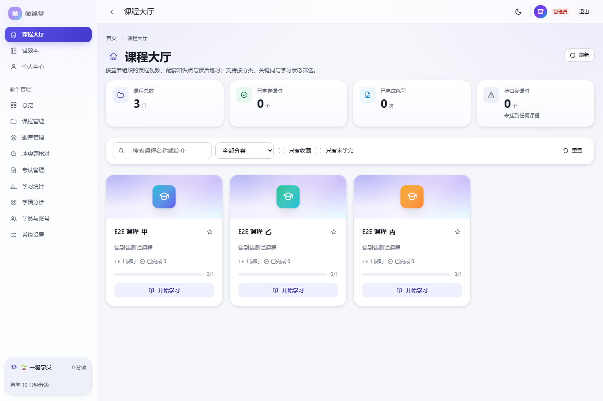
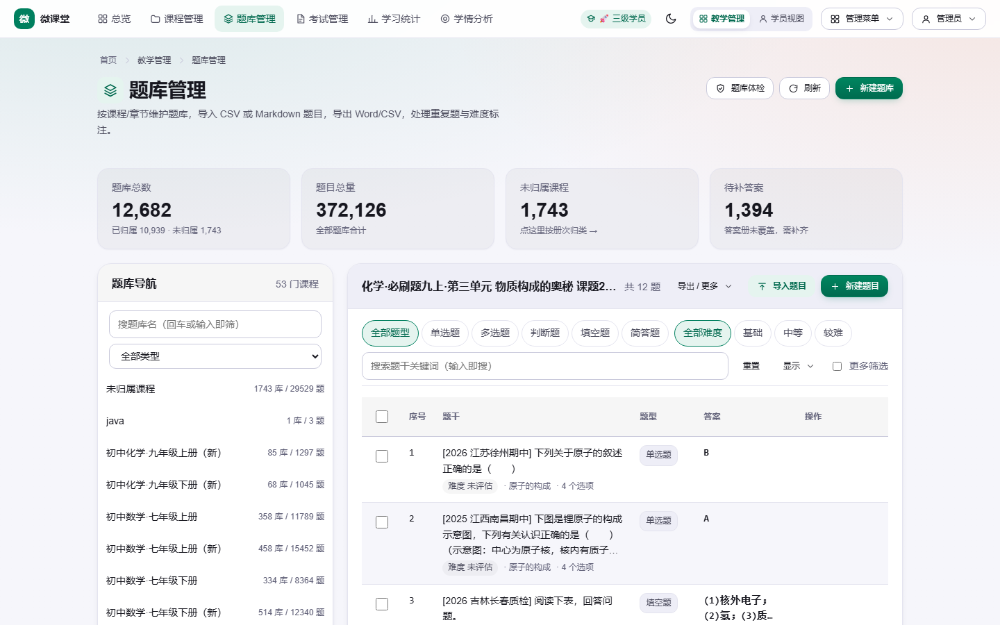
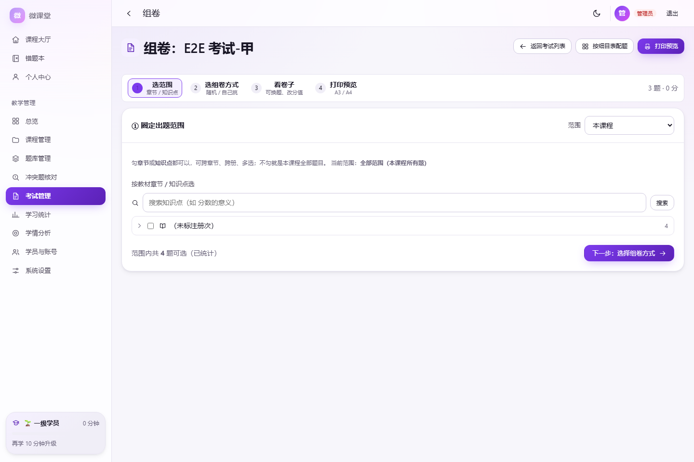
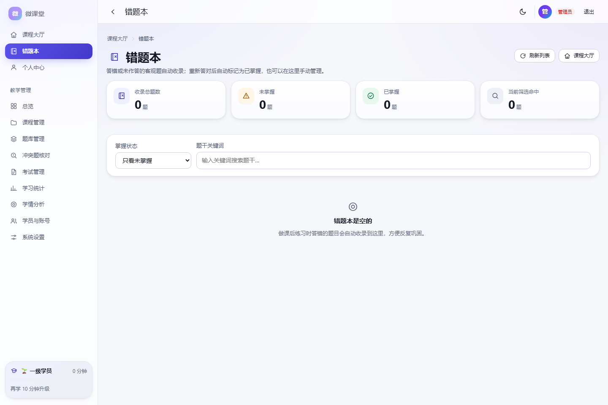
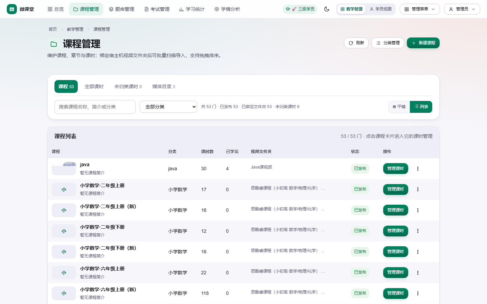
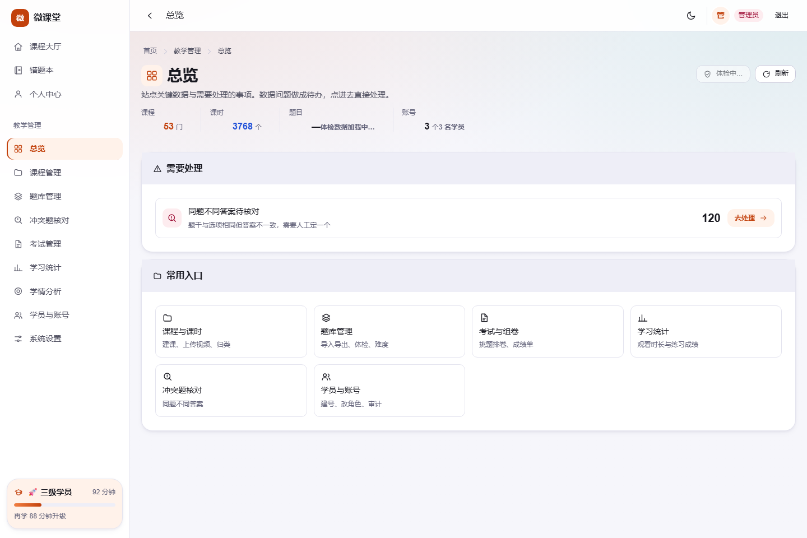
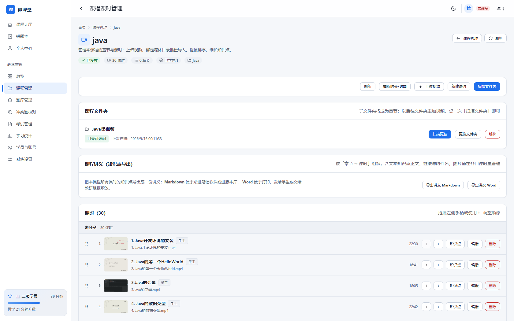
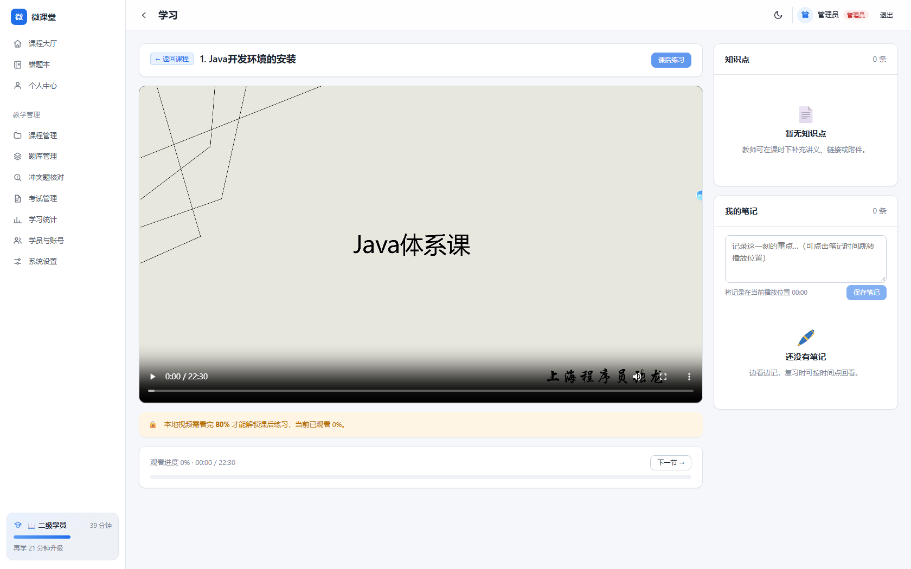

# 微课堂 MicroClass

> 面向班级与机构的**轻量学习平台**：课程 → 章节 → 课时、题库与考试、学习进度与错题本。
> 单机可跑、数据自持、可离线部署，一个 Node 进程 + 一个 SQLite 文件就是全部后端。

[](../../actions/workflows/ci.yml)


---

## 截图

| 学生端 · 课程大厅                 | 教师端 · 题库管理                       |
| --------------------------------- | --------------------------------------- |
|  |  |

| 组卷向导（随机 / 挑选 · 平行卷）          | 错题本（答对自动标记掌握）            |
| ----------------------------------------- | ------------------------------------- |
|  |  |

| 课程 / 课时管理                           | 学员与权限                                 |
| ----------------------------------------- | ------------------------------------------ |
|  |  |

## 视频挂载（3 步）

平台不搬运视频，只**索引**你磁盘上已有的文件：媒体目录（白名单）→ 课程绑定文件夹 → 扫描成课时。
一级目录默认就是章节名，扫完自动生成章节与顺序。

```text
1) 宿主机放好视频：/volume1/media/math7/七年级上册/第一章 有理数/1.1 正数和负数.mp4
2) 启动容器时挂载 + 登记（容器内路径）：
     -v /volume1/media/math7:/media/math7:ro
     MC_MEDIA_ROOTS=[{"id":"math7","name":"数学·七年级","path":"/media/math7"}]
3) 后台：课程管理 → 课程 → 管理课时 → 绑定视频文件夹 → 预览扫描 → 正式扫描
```

| 教师端 · 课时管理（绑定文件夹 / 扫描 / 拖拽排序） | 学生端 · 观看页（断点续播、可拖动进度） |
| ------------------------------------------------- | --------------------------------------- |
|         |   |

也可以**网页直接上传**（无需宿主机权限，受 `MC_MAX_VIDEO_MB` 限制），或填**外链/嵌入**（B 站、自建 CDN，不占服务器磁盘）。

- 完整指南（目录约定与命名、`chapterMode` 章节规则、扫描幂等性、媒体目录权限、时长与封面、播放机制、排错表、最小可用流程）：**[docs/video.md](docs/video.md)**
- 容器挂载与权限：**[docs/deploy.md](docs/deploy.md)**

## 功能

**学生端**：课程大厅 → 课程详情 → 观看页（本地视频/外链、断点续播）→ 练习判分 → 错题本 → 在线考试 → 个人中心
**教师/管理端**

- 课程与课时：媒体目录扫描导入、章节分组、拖拽排序、封面与知识点附件
- **题库管理**：CSV / Markdown / Word 导入导出、五种题型、图片题、重复题与冲突题核对、难度模型（含人工标注优先）、按册次批量归类、显示偏好与键盘流
- **组卷**：按章节/知识点选范围 → 随机组卷或自己挑题 → 卷内替换 → 打印预览（A3/A4）；平行卷一键生成
- 考试与成绩单、学习统计与学情分析、学员与账号管理

**运维**：Docker（多阶段 + 非 root + 健康检查）、fnOS FPK 流水线、`npm run backup/restore` 一致性快照、OpenAPI 3.1、结构化日志与审计

## 快速开始

### 方式 A：Docker（推荐）

```bash
git clone https://github.com/Skarie/microclass.git
cd microclass

docker build -f ops/docker/Dockerfile -t microclass:latest .
docker run -d --name microclass -p 8091:8091 \
  -e MC_ADMIN_PASS='请改成强密码' \
  -v microclass-data:/app/data \
  microclass:latest
# 打开 http://localhost:8091
```

### 方式 B：本地开发（Node ≥ 22.5）

```bash
npm install
cp .env.example .env          # 按需修改（至少改 MC_ADMIN_PASS）
npm run migrate               # 建库 + 迁移
npm run dev                   # API: http://127.0.0.1:8091/api/v1
npm run dev:web               # 前端 dev server（另开一个终端，代理 API）
```

首次启动会按 `MC_ADMIN_USER` / `MC_ADMIN_PASS` 引导创建管理员（默认 `admin` / `admin123`，**正式环境请立即修改**）。

## 技术栈

| 层   | 选型                                                                                           |
| ---- | ---------------------------------------------------------------------------------------------- |
| 后端 | TypeScript · Fastify 5 · `node:sqlite`（WAL）· 分层：routes → services → repositories → db     |
| 前端 | Vue 3.5 · Vite 7 · Pinia · vue-router · 自建设计系统（明暗双主题、令牌化、可访问性守卫）       |
| 数据 | SQLite 单文件；编号 SQL 迁移（`schema_migrations` 版本表 + 校验和防漂移）                      |
| 质量 | prettier · eslint · vue-tsc · vitest · Playwright · GitHub Actions（质量 + E2E + Docker 冒烟） |

架构与依赖方向：[docs/architecture.md](docs/architecture.md)｜接口：[docs/api.md](docs/api.md)（运行时 OpenAPI：`GET /api/v1/openapi.json`）

## 目录结构

```
apps/api         后端服务（routes → services → repositories → db）
apps/web         前端应用（Vue3 + Vite + TS，含自建设计系统）
packages/shared  前后端共享类型 / 常量 / 错误码
db/migrations    编号 SQL 迁移
ops              部署与运维（Docker / Compose / FPK / 备份）
docs             架构 / API / 部署 / 运维 / 安全 / 发布 / 使用说明
tests/e2e        Playwright 端到端测试
```

## 常用命令

| 命令                                                          | 说明                                          |
| ------------------------------------------------------------- | --------------------------------------------- |
| `npm run dev` / `npm run dev:web`                             | 启动 API（tsx watch） / 前端 dev server       |
| `npm run build`                                               | 构建 shared → api → web                       |
| `npm run format:check` / `npm run lint` / `npm run typecheck` | 格式 / 规范 / 类型门禁                        |
| `npm run test` / `npm run test:coverage`                      | 单元与集成测试 / 覆盖率门禁                   |
| `npm run test:e2e`                                            | Playwright 端到端测试（需先 `npm run build`） |
| `npm run migrate`                                             | 执行数据库迁移                                |
| `npm run backup` / `npm run restore`                          | 数据备份 / 恢复（一致性快照）                 |
| `npm start`                                                   | 生产模式启动（需先 build）                    |

## 配置

完整变量见 [.env.example](.env.example)。常用项：

| 变量                                               | 默认                  | 说明                                        |
| -------------------------------------------------- | --------------------- | ------------------------------------------- |
| `MC_ENV`                                           | `development`         | `development` / `test` / `production`       |
| `MC_HOST` / `MC_PORT`                              | `0.0.0.0` / `8091`    | 监听地址与端口                              |
| `MC_DATA_DIR`                                      | `./data`              | 数据目录（SQLite、上传、会话密钥）          |
| `MC_SITE_NAME`                                     | `微课堂`              | 站点名称                                    |
| `MC_ADMIN_USER` / `MC_ADMIN_PASS`                  | `admin` / `admin123`  | 首次引导管理员（已存在则不覆盖）            |
| `MC_ALLOW_REGISTER`                                | `true`                | 是否开放学生自助注册                        |
| `MC_SESSION_SECRET`                                | 自动生成              | 会话签名密钥（未配置则写入 `data/.secret`） |
| `MC_MAX_VIDEO_MB` / `MC_MAX_UPLOAD_MB`             | `2048` / `50`         | 上传上限                                    |
| `MC_MEDIA_ROOTS`                                   | 空                    | 允许登记为媒体目录的宿主机路径              |
| `MC_RATE_LIMIT_MAX` / `MC_RATE_LIMIT_WINDOW`       | `300` / `1 minute`    | 限流                                        |
| `MC_ALLOWED_ORIGINS` / `MC_TRUST_PROXY` / `MC_CSP` | 空 / `true` / `false` | 反向代理与跨站策略                          |

## 测试与质量门禁

```bash
npm run format:check && npm run lint && npm run typecheck && npm run test && npm run build
npx playwright test        # 端到端（面向生产构建产物）
```

当前状态：单元与集成测试 **477 通过 + 1 跳过（51 个文件）**；Playwright E2E **32 项全通过**（含视觉回归与无障碍检查）。
CI 会在每次 PR 跑「质量 / E2E / Docker 镜像冒烟」三个 job，并设 `npm audit --omit=dev --audit-level=high` 依赖漏洞门禁。

**工程约束**：任何写操作都要有 schema 校验、鉴权守卫与审计记录；错误统一走错误信封；新增表结构必须通过迁移文件，不修改历史迁移。

## 文档

- 架构与依赖方向、可观测性：[docs/architecture.md](docs/architecture.md)
- 接口说明（另有 OpenAPI 3.1）：[docs/api.md](docs/api.md)
- 部署（逐步：Docker / 本地+systemd / fnOS FPK / 反向代理 / 升级回滚 / 自检清单）：[docs/deploy.md](docs/deploy.md)
- **视频挂载**（媒体目录扫描 / 网页上传 / 外链、章节划分、权限与排错）：[docs/video.md](docs/video.md)
- 教师使用说明：[docs/usage.md](docs/usage.md)
- 运维手册（巡检、日志、备份恢复、定时任务）：[docs/ops-runbook.md](docs/ops-runbook.md)
- 安全设计与复核记录：[docs/security.md](docs/security.md)
- 版本与发布、升级回滚：[docs/release.md](docs/release.md)
- 参与开发：[docs/contributing.md](docs/contributing.md)
- 变更记录：[CHANGELOG.md](CHANGELOG.md)

## 参与贡献

欢迎 Issue 与 PR：请先阅读 [docs/contributing.md](docs/contributing.md)（开发环境、提交规范、必过的门禁）。
安全问题请按 [docs/security.md](docs/security.md) 的方式私下反馈，不要直接开公开 Issue。

## 免责声明

本项目**只包含平台代码，不附带任何教材、教辅或题库内容数据**。
如果你用它导入自有资料（例如扫描版课后习题），请自行确保拥有相应版权或使用授权；
因导入内容产生的版权问题与本项目作者无关。

## 许可

[MIT](LICENSE)
